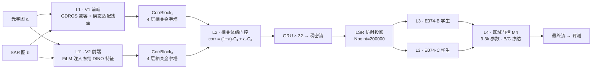

<div align="center">

# VSMatch

**面向光学–SAR 跨模态图像匹配的双路相关体融合与区域门控方法**

[](#)
[-2E8B57)](#)
[](#)
[](#)
[](#)

</div>

> 本仓库记录方法实现、评测协议与结果。克隆本仓库后，从
> **[当前方法设计](docs/METHOD_DESIGN.md)** 开始读；需要数字看
> **[当前结果与已知短板](docs/RESULTS_OS.md)**，需要复现看
> **[评测口径](docs/EVALUATION_PROTOCOL.md)** 与 **[复现指南](docs/REPRODUCE.md)**。
> 数据集、权重与预测张量不入库。

<details>
<summary><b>目录</b></summary>

- [最近更新](#最近更新)
- [核心特性](#核心特性)
- [方法架构](#方法架构)
- [当前结果](#当前结果)
- [已知短板](#已知短板)
- [仓库结构](#仓库结构)
- [复现边界](#复现边界)
- [路线图](#路线图)

</details>

---

## 最近更新

| 日期 | 内容 |
|---|---|
| **2026-11-14** | 补齐当前方法设计、统一评测口径与全量 424 对结果文档；同步评测与消融脚本；完成 V2 分支的**诊断性零训练旁路**（不构成模块消融结论，见 [ABLATION_V2.md](docs/ABLATION_V2.md)） |
| **2026-11-13** | 核实 GDROS 官方复现无误：官方 `test.py` 计算的是**逐分量绝对误差**，本项目用**向量 EPE**，两者 AEPE 相差约 π/2；补跑官方口径下 M4 结果；完成 Top-25 失败配对归因 |
| **2026-11-02 ~ 10-31** | 定位 CMR 阈值交叉现象：重尾继承自 E074 B/C 双分支，门控为软加权且 oracle 也无法补救；鲁棒仿射拟合被实验否定为主因 |
| **2026-09-30** | 冻结 E072 → E073 → E074 → E075A 实现链与阶段性结果卡 |

> ⚠️ `research/CURRENT_METHOD_STATE.md` 及 `research/results/` 下的 2026-09 结果卡是**历史快照**，
> 其指标口径与最新结论以 `docs/` 下的文档为准。

---

## 核心特性

1. **分层对齐的跨模态前端，而不是替换 backbone。** 保留 GDROS 官方
   `FeatureEncoder`（stride-8 / 256 通道 / raw dot-product）与 `FeatureTransformer` 的分布，
   只叠加零初始化的模态适配残差，以及一层冻结 DINO 特征的 FiLM 注入。直接把特征换成
   1024 维描述子会把 context / CorrBlock / GRU 推入 OOD（早期实验 AEPE 18.67、CMR@2 1.17%）。
2. **在相关体层面融合两路证据。** V1（GDROS 兼容，强局部纹理）与 V2（DINO 辅助，强全局语义）
   各自构建 CorrBlock，按可学习标量门控融合
   `corr = (1-a)·Corr₁ + a·Corr₂`，再送 GRU 迭代。相关体是二者唯一的公共度量空间。
3. **双学生 + 区域级门控，把紧阈值精度与松阈值召回拆开。** E074-B（平衡）/ E074-C（紧精度）
   两个学生冻结后，由仅 **9.3k 参数**的区域门控在 4×4 区域尺度上裁决，
   `out = (1-g)·B + g·C`，避免逐像素高频抖动。
4. **门控标签由评测指标本身定义。** 标签 `sigmoid((e_B − e_C)/τ)` 来自两支各自 LSR 后
   的逐像素 EPE，直接对齐多阈值 CMR；损失为 `Lseq + Lgeo + 0.35·BCE + 0.20·CVaR₁₀%
   + 0.03·熵 + 0.05·均值平衡`。
5. **评测口径全量核查并公开。** 官方 `test.py`、论文 Table II、项目内部向量 EPE 三套数字
   的关系已逐位对齐，见 [评测口径](docs/EVALUATION_PROTOCOL.md)。

> 定位说明：CorrBlock、GRU 迭代、LSR、DINOv2 特征均为已有组件（GDROS / DINOv2）。
> 本工作的贡献是**融合结构与门控监督方式**，不主张发明 recurrent geometry 或稠密匹配本身。

---

## 方法架构



链路对应实现：[E072 前端](research/remote_stage/os/e072a_layerwise_frontend_alignment.py) →
[E073 相关体融合](research/remote_stage/os/e073a_v1_v2_fusion_longtrain.py) →
[E074 双学生](research/remote_stage/os/e074a_f2_f3_twostage_fusion.py) →
[E075A-M4 区域门控](research/remote_stage/os/e075a_preserve_high_precision_recover_c2c5.py)。

---

## 当前结果

保护版本 **E075A-M4@80K**（`M4_step80000.pt`），OS 数据集全量 **424 对**，
`iters=32`、LSR 200k。两套口径**必须分开读**，不能直接与论文表格混排：

| 口径 | 方法 | AEPE↓ | CMR@1↑ | CMR@2↑ | CMR@5↑ |
|---|---|---|---|---|---|
| **官方 `test.py`**（逐分量误差，可与论文并列） | GDROS 官方权重 | **1.4618** | 33.73 | 81.60 | **99.53** |
| | **E075A-M4@80K** | 1.4738 | **72.41** | **84.91** | 94.10 |
| **项目内部向量 EPE**（配对级，内部消融用） | GDROS 官方权重 | **2.3216** | 9.43 | 52.12 | **94.34** |
| | **E075A-M4@80K** | 2.3669 | **52.59** | **79.72** | 88.92 |

**结论**：官方口径下 M4 的 CMR@1 是论文 GDROS（33.88%）的两倍以上，
三档 `AEPE@τ` 低 36–47%，全部 AEPE 基本持平（1.4738 vs 1.4618）；
代价是 CMR@5 落后 5.42 pp。完整指标、逐像素口径、截断式 `AEPE@τ`
与三种 RMSE 定义见 [当前结果](docs/RESULTS_OS.md)。

**诊断性旁路（非模块消融，不进结果主表）**：2026-11-14 在冻结权重上直接把
V2 那一路的贡献置零（不重训），AEPE `1.4738 → 7.7457`。这测的是
**下游对输入分布偏移的敏感性**，不是 V2 的边际贡献 —— 大幅退化里混合了
「少了一路信息」和「下游 OOD」两个无法分离的原因，因此不能写成
「去掉 DINO 模型就废了」。真正的模块消融需要重训单路，见
[V2 旁路诊断](docs/ABLATION_V2.md) §4.1。

---

## 已知短板

- **尖峰 + 重尾**：多数配对 <1 px，但约 6% 的灾难配对有 10–20 px 误差，
  把官方栏位 `RMSE`（实为 `np.var(MAE_list)` 方差）从 0.7463 顶到 8.3350。
- **失败集中在 1.10 尺度档**：按官方口径排序的 Top-25 中 23/25 落在该档；
  主因是**跨模态稠密对应阶段的平移估计失效**（`α≈0.80`），
  不是 LSR 几何重建（23/25 对 `|ΔLSR|<0.5`），也不是区域门控（两支 oracle 仍 >5 px）。
  GDROS 官方权重在同一 25 对上平均仅 1.2595，说明不是数据本身难。
- **门控置信度未校准**：最自信处恰是 oracle 也最难的像素（U 形）。

细节与证据见 [Top-25 归因](research/results/OS_20261113/M4_Top25误差归因_20261113.md)
和 [CMR 现象分析](research/results/OS_20261113/CMR_现象分析.md)。

---

## 仓库结构

| 路径 | 内容 |
|---|---|
| [`docs/METHOD_DESIGN.md`](docs/METHOD_DESIGN.md) | **当前方法设计**（分层结构、损失、超参、设计依据） |
| [`docs/RESULTS_OS.md`](docs/RESULTS_OS.md) | 当前指标、误差结构、口径对照 |
| [`docs/ABLATION_V2.md`](docs/ABLATION_V2.md) | V2（DINO 辅助）分支零训练消融：定义、结果、边界 |
| [`docs/EVALUATION_PROTOCOL.md`](docs/EVALUATION_PROTOCOL.md) | CMR / AEPE / RMSE 定义与 π/2 口径更正 |
| [`docs/REPRODUCE.md`](docs/REPRODUCE.md) | 环境、路径约定、复现命令与限制 |
| `research/remote_stage/os/` | E072–E075A 训练与模型实现（冻结版本） |
| [`research/eval/`](research/eval/README.md) | 评测脚本与零训练消融脚本 |
| `research/results/OS_20261113/` | 2026-11-13 一手评测报告与原始指标 JSON |
| `research/results/OS_20261114/` | 2026-11-14 分支消融原始结果 JSON（含逐对 EPE） |
| `research/experiments/`、`research/results/` | 早期方法搜索的规格、结果卡与审计记录 |
| `research/CURRENT_METHOD_STATE.md` | 2026-09 历史方法状态快照 |

---

## 复现边界

仓库不附带 GDROS 源码、OS 数据集和 checkpoint。实验脚本从部署工作区导入上游 GDROS 代码，
通过 `SPARSEGEO_ROOT` 指定根目录；历史 zzvr 布局仍是默认值，以保留冻结实验的原始行为。
`research/eval/` 下脚本的路径常量需要按实际工作区调整，见该目录 README。

本地可做的静态检查：

```bash
python -m pip install -r requirements-research.txt
python -m compileall -q tools research/remote_stage research/eval e081a_whu_our_native_train.py
python -m unittest discover -s tools -p 'test_*.py'
python scripts/preflight.py --scope all
```

---

## 路线图

- [x] E072 分层前端对齐 → E073 相关体级融合 → E074 双学生 → E075A 区域门控
- [x] OS 424 对全量评测，两套口径分别与 GDROS released / 论文 Table II 对齐
- [x] 重尾归因到跨模态对应层，排除 LSR 与门控主因
- [ ] 难度递增的难例合成，覆盖 1.10 尺度档的平移失效
- [ ] 从 GDROS released 蒸馏并加正则，恢复难配对匹配能力
- [ ] 门控置信度校准与弃权机制
- [x] 上游前端诊断性旁路（冻结权重、零训练，只测敏感性；**不等于模块消融**）
- [ ] 适配性续训（固定单路，冻结前端只续训 B/C + L4 gate 2K–8K 步）后按官方口径复测
- [ ] 严格模块消融：同预算重训单路 E073 → E074 → M4，才能量化 V2 的边际贡献
