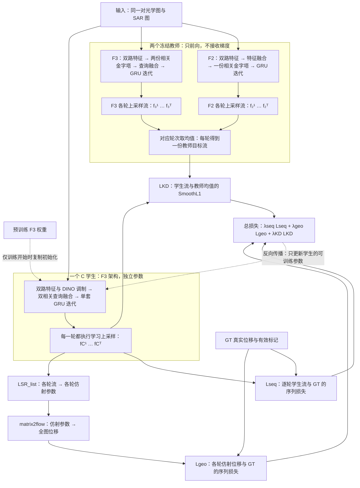
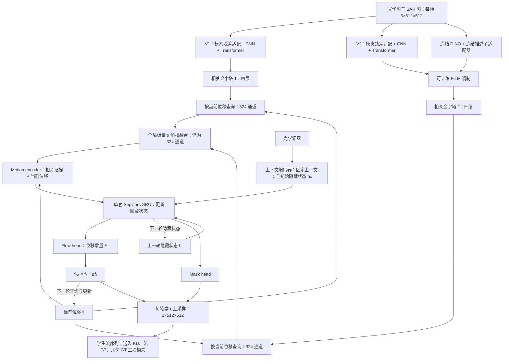
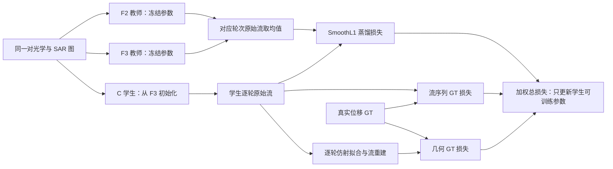

# C/student 的蒸馏位置与历史训练耗时

核查日期：2026-11-16。证据来自 E074-C 历史脚本、实际训练日志、检查点及文件系统时间；本次没有训练模型。

## 训练网络架构总图

“双教师流蒸馏”指历史 **E074 的 C 阶段**：同一对图像同时由两个冻结教师和一个可训练学生处理。不是 DINO 分别教光学与 SAR，也不是 B、C 两分支彼此蒸馏。

F2、F3 是两个事先训练好的完整匹配网络。两者都使用 V1/V2 特征；F2 在特征层融合后构建一份相关金字塔，F3 分别构建两份相关金字塔、在查询结果层融合。C 学生采用 F3 架构，并从 F3 权重初始化，但拥有独立参数副本。

实线表示前向数据流，虚线标明初始化与反向更新。损失不把 GT 作为网络的推理输入；GT 只用于训练监督。历史 KD 的 `SmoothL1` 对整份预测流计算，未使用 GT valid mask；GT 两项损失则接收 `valid`。

训练循环的默认 T=12；当前评测推理是 32 轮。训练不能直接套用当前“仅末轮上采样”的精简推理路径，因为历史训练损失使用每一轮的全分辨率流。

## 学生内部展开图

为易读，初始化零位移与隐藏状态的具体 tanh/ReLU 省略。两路特征都处理光学和 SAR，形成各自的一对匹配特征；两份相关体建立后在本对图像的 GRU 迭代期间固定。学生的 DINO/描述子适配器不更新参数，参与有效前向的模态适配、特征前端、FiLM、相关融合标量、上下文编码器与循环更新模块接受损失梯度。

## 一轮训练的代码对应

历史 `e074a_f2_f3_twostage_fusion.py` 中：

1. `E074Model.__init__`：构造 F2、F3 教师和从 F3 初始化的 `student`；教师参数设为不求梯度。
2. `teacher_preds`：`torch.no_grad()` 下得到两个教师的流序列。
3. `forward`：`self.last_teacher_avg = [0.5 * (x2 + x3) ...]`，建立逐轮目标；返回学生流序列。
4. `train`：计算 `lseq`、`lgeo` 和学生流对 `last_teacher_avg` 的 `distill`。
5. `loss.backward()`、`opt.step()`：三项损失共同更新学生的可训练参数。

三项损失全部来自同一个学生输出序列。GT 教学生“真实对应在哪里”，KD 教学生“两个固定教师对这个对应的平均预测是什么”，几何项约束“整个位移场拟合成全局仿射后是否符合 GT”。教师平均有可能不准，因此蒸馏是额外训练约束，其实际收益仍需要 KD 开关消融确认。

## 蒸馏发生在训练损失中

C 的学生架构是 F3，先加载已经训练到 step120000 的 F3。另加载 F2、F3 两个教师，冻结教师参数，通过 `torch.no_grad()` 计算教师各轮的全分辨率原始位移预测。

对同一输入图像对，第 t 轮的教师目标为：

\[
\bar f_t=\frac{f_t^{F2}+f_t^{F3}}2.
\]

学生产生自己的预测序列 \(f_t^C\)，蒸馏损失为：

\[
L_{KD}=\frac1T\sum_{t=1}^T\operatorname{SmoothL1}(f_t^C,\bar f_t).
\]

`F.smooth_l1_loss` 使用默认 mean reduction，每轮先对该轮张量求平均，再对迭代轮次平均。教师目标是 **LSR 之前的流**；没有蒸馏教师特征、GRU 隐藏状态或仿射矩阵。教师也不是训练后的 B 分支，而是 E073 的 F2 和 F3。

同时计算两个 GT 监督项：

\[
L=\lambda_{seq}L_{seq}(f^C,f^{GT})
 +\lambda_{geo}L_{seq}(\operatorname{matrix2flow}(\operatorname{LSR\_list}(f^C)),f^{GT})
 +\lambda_{KD}L_{KD}.
\]

`LSR_list` 对各轮流拟合仿射位移，再由 `matrix2flow` 转回位移场监督；它是可求导的计算，没有额外可学习 LSR 参数。这个几何监督项与蒸馏项是两个不同来源的约束。

保留脚本的默认参数为：`lambda_seq=0.5`、`lambda_geo=0.5`、`distill_weight=0.2`、`train_iters=12`、`lr=3e-5`。本次未找回原始启动命令，因此这些数字按“脚本默认值”记录，不能断言历史命令没有覆盖默认值。训练日志及保存的 curves 能直接确认训练步数和蒸馏损失的存在。

对应代码：

- [教师、学生构造和逐轮平均目标](../research/remote_stage/os/e074a_f2_f3_twostage_fusion.py)：`E074Model.__init__`、`teacher_preds`、`forward`。
- [蒸馏与 GT 损失](../research/remote_stage/os/e074a_f2_f3_twostage_fusion.py)：`train` 中 `distill` 和 `loss += ...`。
- [后续冻结 C 的 M4 阶段](../research/remote_stage/os/e075a_preserve_high_precision_recover_c2c5.py)：`PairFusion` 构造中冻结 B/C 参数。

蒸馏的梯度更新学生的可训练匹配参数，教师不随这一步更新。学生内部原来冻结的 DINO/描述子前端继续保持参数冻结。蒸馏并非推理时插入一个额外模块，而是影响最终学生权重。

## 为什么精简版没有教师，仍然叫 student

E075 的外层融合训练冻结了 C。本次逐张量比对确认：历史 `C_step180000.pt` 的 `student.*` 与受保护 M4 的 `c.student.*` **全部 1,114 个 state entries 精确相同**。

E099 随后从这个学生中提取参与最终输出的模块，删除教师、其他匹配器和冗余计算，得到当前 `M4-streamlined-C-student`。OS424 上全部最终预测与原 C 一致。因此它继承的是经过蒸馏的 C 权重，而不是未经蒸馏的 F3 原权重。

推理只需要学生和最后一次 LSR。这里的“单学生”指一套循环匹配器；学生内部依然有两路特征前端和两份相关金字塔。蒸馏将两个教师的预测知识迁移给一个 F3 学生，并没有把学生改成比 F3 更窄的网络。

这里需要区分两种“教师”叫法：**F2/F3 蒸馏教师已经从推理中移除，但冻结 DINO 仍是学生特征路径的一部分，每对图像执行两次 DINO 前向**。历史 DINO 提取工具的名字含 `teacher`，不表示当前 C 推理可以一并删除它。

| 项目 | C 蒸馏训练 | 当前 C 精简推理 |
|---|---|---|
| F2/F3 完整教师匹配器 | 生成逐轮流目标，不更新参数 | 不构造、不执行 |
| C/F3 学生匹配器 | 前向、计算损失、反向更新可训练参数 | 只前向，32 轮 |
| 学生内部 DINO/描述子适配 | 保留，参数冻结 | 保留，参数冻结 |
| 蒸馏损失与 GT 监督 | 计算 | 不计算 |
| 仿射几何计算 | 逐轮用于几何监督 | 仅最终一次官方 LSR |

尚未完成“同样初始化和训练预算、仅关闭 KD”的严格对照，所以不能把 C 的精度收益全部归因于蒸馏。
推理删除教师后预测不变，只说明教师输出没有被推理使用，不能说明训练蒸馏没有贡献；确认贡献需要重新训练这组 KD 消融。

## 历史 C 阶段花了多久

实际 run：`E-074A-ZZVR-F2F3-TWOSTAGE-FUSION/run-c-stage180k`，2026-09-04，机器时区 CST +0800。

| 记录 | 时间 |
|---|---|
| 训练日志创建 | 07:20:29 |
| C step140000 检查点写完 | 10:30:08 |
| C step160000 检查点写完 | 12:53:57 |
| C step180000 检查点写完 | 15:11:23 |
| 最后一次评测结束、日志最后写入 | 15:15:58 |

从日志创建到最后写入约 **7 小时 55 分 29 秒**。这是可核查的阶段墙钟区间，包含初始化、200 步 toy、正式训练、检查点保存、三次里程碑评测和可能的等待，不是纯 GPU 训练时长。

实际正式循环是 step120001 到 step180000，**新增 60,000 步**，另有 200 步 toy，共新增 60,200 次优化更新。`180K` 是承接初始化链路的步骤标签，不能写成“C 从零训练了 180K 步”。

历史 `resource_report.json` 的 `elapsed_seconds=1.9104757` **无效**：训练代码在循环结束后才传 `time.time()` 给 `finalize`，后者相减测到的是收尾时间。原文件保留不改，审计中标记这个字段不能用于训练成本。

## 对下一次训练的含义

- 已有 F2/F3 权重、重跑相同规模 C 蒸馏阶段，可将历史约 8 小时作为排期参考；当前负载、实现和设备会影响实际时长。
- 从头复现全部方法还要加上 V1/V2、F2/F3 及其前置 DINO/适配器准备成本；本次约 8 小时没有包含这些成本。
- 当前精简操作没有重新训练，因此新增训练成本为零。
- 当前精简类明确是 inference-only，`forward` 带 `torch.inference_mode()`，仅保留最终输出。下一次训练应使用历史可训练学生路径，保留逐轮输出与损失，训练后再提取精简推理图。
- 训练时需要两个教师前向、学生前向及反向，还要计算逐轮流和几何损失。不能用当前约 143 ms/对的推理时间直接推算每个训练 step。

机器可读证据和可重复的只读审计入口：

- [历史训练审计 JSON](../research/results/E100A_STREAMLINED_C_WHU_UBCV2_20261116/C_TRAINING_HISTORY_AUDIT.json)。
- [审计脚本](../research/remote_stage/os/audit_c_training_history.py)，`--verify-weights` 会比较 C180K 与 M4 中的学生张量。
