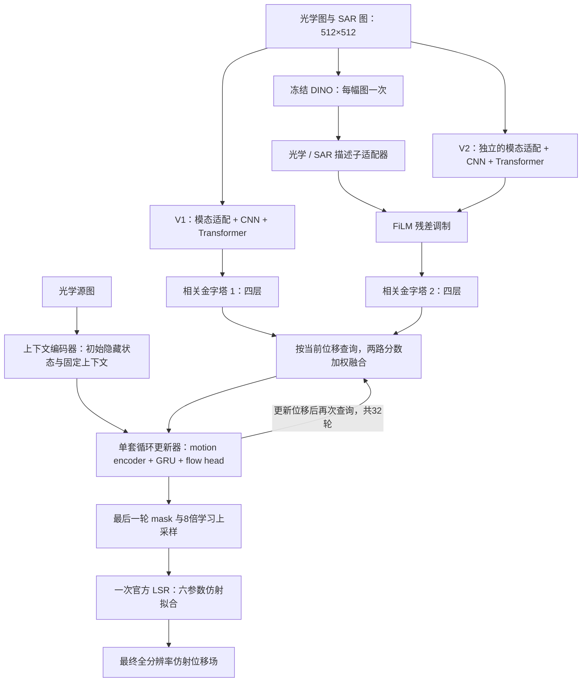

# C 精简版架构及与 GDROS 的区别

2026-11-16，对照已执行 E099A 的核心实现、GDROS 官方前向及 C 的训练代码核对。

**当前 C 精简版是 DINO 辅助的双路特征、双相关金字塔、单套 GRU 迭代匹配与一次最终 LSR。两路证据在进入 GRU 前融合；当前推理不包含 B/C 流融合或区域门控。**

## 网络总图

V1/V2 都处理同一对图像，各自产生光学和 SAR 特征；不是分别只处理一种模态。图中的两个相关金字塔不意味着两套 GRU。

## 逐步输入与输出

**1. 双路特征提取。** 输入两个 `[1,3,512,512]` float32、0..255 张量。主匹配分支先归一化为 [-1,1]。V1 与 V2 各有两个浅层模态输入适配器和一套 GDROS 风格 CNN/位置编码/FeatureTransformer，输出各自的 `[1,256,64,64]` 光学、SAR 特征。每一路内部 CNN 对两幅图共享，两路前端分别保存自己的参数。GDROS 本身也有 CNN 与 Transformer，这些组件不是本方法新增。

输入适配器的形式为 `clip(x + 0.1·Adapter(x), -1.5, 1.5)`，Adapter 是 3→24→3 的两层卷积与 GELU，训练初始化时最后一层为零。其设计意图是在保留基础分布的前提下适配跨模态外观；实际最终权重已训练，不能把零初始化理解成最终仍是恒等变换。

**2. DINO 辅助 V2。** 冻结 DINO 分别处理光学/SAR 图，得到描述子；当前工具先在 518 输入上提取 37×37 patch tokens，再插值为 `[1,1024,32,32]` 并归一化。经光学/SAR 描述子适配后，插值到 64×64，投影成两个 256 通道的调制张量：

\[
F'_2=F_2+0.05\left(\tanh(\gamma(D))\odot F_2+\beta(D)\right).
\]

分别对光学和 SAR 特征应用同一形式。SAR 描述子适配器还接收原始 SAR 图。DINO 在这里提供辅助证据，最终用于计算相关体的仍是 256 通道匹配特征。当前推理中 DINO/描述子适配器被冻结；其参数来自既有训练，不是随机模块。

“V1 偏局部、V2 补语义”是设计动机，尚不能当作已通过独立消融确认的贡献分解。

**3. 构建两份 4D 相关体及四层金字塔。** 分别用 V1 和 DINO 调制后的 V2 特征，计算所有源位置与所有目标位置的点积（除以通道数平方根）。基本空间形状为 `64×64×64×64`；前两维为源位置，后两维为目标位置。四层仅池化目标维度，使目标网格依次为 64/32/16/8。相关体在每对图像的迭代开始前建立，32 轮中保持固定。

**4. 每轮查询并融合相关分数。** 按当前目标坐标，在两份金字塔每层各查半径 4 的 9×9 邻域。单路得到 `4×9×9=324` 通道的局部相关证据，采用

\[
r_t=(1-\alpha)r_{1,t}+\alpha r_{2,t},\qquad
\alpha=\sigma(\texttt{corr\_gate\_logit}).
\]

融合后仍是 324 通道，未拼接为 648 通道，因此可以沿用同样输入维度的更新器。当前 E099A 精简权重实读 logit=0.007009462，**α=0.501752377**，约为两路近似等权混合。这是推理时固定、对所有样例/位置/迭代共享的一个全局标量，不是区域门控或动态置信度。系数接近一半也不能证明两路独立贡献各占一半。

**5. 单套 GRU 更新。** 光学源图经过 context encoder 输出 `[1,256,64,64]`，拆成 128 通道的初始隐藏状态和 128 通道固定上下文。前者经 tanh、后者经 ReLU。当前位移与融合相关分数经 motion encoder 产生 128 通道运动证据；固定上下文与运动证据拼接后进入 SepConvGRU：

\[
m_t=\operatorname{MotionEncoder}(f_t,r_t),\quad
h_{t+1}=\operatorname{GRU}(h_t,[c,m_t]),\quad
f_{t+1}=f_t+\operatorname{FlowHead}(h_{t+1}).
\]

初始位移为零，每轮保持 `[1,2,64,64]` 位移和 `[1,128,64,64]` 隐藏状态。32 轮共享同一套更新参数。这个循环机制、隐藏状态维度、位移增量预测方式沿用 GDROS；主要变化是喂给更新器的匹配证据。

**6. 最终学习上采样与 LSR。** 最后一轮才生成 mask，并以学习到的凸组合上采样到 `[1,2,512,512]`。之后执行唯一的官方 `LSR(1,512,512,flow,200000)`，拟合六参数仿射映射，再生成最终稠密位移。LSR 不反馈给 GRU，也不进入当前 C 的中间门控。函数最终返回稠密流，不代表拟合了自由度很高的逐像素变换。

## 与官方 GDROS 的对照

| 环节 | 官方 GDROS，当前评测实现 | C 精简版 |
|---|---|---|
| 基础特征框架 | 一路 CNN + Transformer | 两路同类前端，各自产生两模态特征 |
| 模态输入适配 | 无上述额外适配器 | 每路有光学/SAR 残差适配器 |
| DINO 辅助 | 无 | 冻结 DINO + 描述子适配 + FiLM 调制 V2 |
| 相关金字塔 | 一份，四层 | 两份，各四层 |
| GRU 前的相关证据 | 单路查询 324 通道 | 两路查询加权，仍为 324 通道 |
| 循环更新结构 | motion encoder + SepConvGRU + flow head | 同类结构，已有学习权重不同 |
| GRU 轮数 | 32 | 32 |
| 最终全局拟合 | 一次仿射 LSR | 同一次官方仿射 LSR |
| 推理 mask/上采样 | 每轮执行，共 32 次 | 最后一轮执行，共 1 次 |
| 训练来源 | 官方 GDROS 训练模型 | F3 初始化，并经过 F2/F3 教师蒸馏与 GT 监督 |

架构上的变化集中在模态适配、DINO 条件特征调制、双相关证据融合。GRU 和 LSR 的基本机制被保留。仅最后一轮上采样、去掉重复 context/无用模块及缓存网格属于工程优化；GDROS 也可以尝试对应优化，不能将其表述为独有的匹配机制或据此断言速度优于 GDROS。

## C 的训练身份

C 从 F3 初始化，历史 E074-C 训练时以冻结 F2/F3 的原始流均值为教师，同时使用 GT 序列流损失和仿射几何损失：

\[
L_C=\lambda_{seq}L_{seq}+\lambda_{geo}L_{geo}
+\lambda_{distill}\operatorname{SmoothL1}
\left(f_C,\tfrac12(f_{F2}+f_{F3})\right).
\]

公式省略了迭代序列求和/平均。它是训练期多教师、推理期单学生；当前推理既没有 F2/F3 教师，也不调用 B。E075A 的区域门控训练冻结了 B/C，所以取出的 C 不应被描述成接受了 M4 区域门控/尾损失联合重训的网络。本次精简也没有新训练。

## 已证实与待证实

E099A 全部 424 对最终流与历史 C 缓存逐元素一致；CMR@1/2/5 为 69.5755/85.1415/92.9245%，独立计时均值 143.476 ms。参数 319,303,309，其中 DINO 304,367,616；排除 DINO 为 14,935,693。耗时是 RTX 5090 GPU3、FP32/batch1 的本轮结果，尚无同轮 GDROS 对照。

这些结果验证了当前整体方案与精简等价性，尚不能把高 CMR@1 单独归给 DINO、双相关或蒸馏；需要受控训练消融区分它们。未来可分别检验内容相关的融合权重、DINO 轻量化，以及以单学生承接更多教师信息，不能提前承诺收益。

## 代码与证据

- 独立包装：[m4_streamlined_c_student.py](../research/remote_stage/os/m4_streamlined_c_student.py)。
- 活跃前端、相关融合与循环：[m4_clean_deploy.py](../research/remote_stage/os/m4_clean_deploy.py)。
- 模态适配、FiLM 原型：[E072A](../research/remote_stage/os/e072a_layerwise_frontend_alignment.py)。
- C 训练/蒸馏：[E074A](../research/remote_stage/os/e074a_f2_f3_twostage_fusion.py)。
- 全量新推理与耗时：[E099A 报告](../research/results/E099A_STREAMLINED_C_STUDENT_OS424_20261116/REPORT.md)。
- 已执行源快照在本地忽略目录 `outputs/streamlined_c_student_os424_20261116/source_snapshot/`。GDROS 官方 `gdros.py`、`encoder.py`、`update.py` 和 `corr.py` 在 zzvr 上逐项核对，没有改动上游源码。
