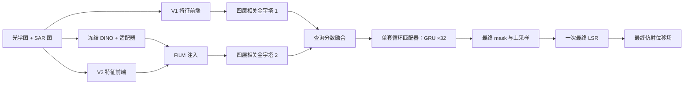

# 精简 C/student 独立推理：参数、耗时与 OS424 性能（E099A）

网络逐层结构、训练身份及与 GDROS 的区别见 [架构说明](../../../docs/M4_STREAMLINED_C_STUDENT_ARCHITECTURE.md)。

2026-11-16。已完成 **M4-streamlined-C-student** 的独立精简实现及 OS 全部 424 对新推理。没有训练，没有运行完整 M4 作耗时对照。结论：**C/student 只有一套循环匹配器，内部仍保留双路特征、双相关金字塔和冻结 DINO；精简后全部预测不变，独立平均耗时 143.476 ms/对。**

## 独立精简了什么

原 B 包含 F2、F3 两套匹配器及流融合门控；C 实际输出来自一套 F3 student。本轮使用 E093A 已验证的 C 前缀构造器，严格加载受保护 M4 step80K 的 `c.student.*`，然后提取最终输出所需模块，**没有构造 B 或 C 的教师匹配器**。历史构造产生的闲置嵌套模块和未精简 C 对照，在正式计时前被删除。

新模型仅注册 `dino`、`descriptor_adapters`、`matcher` 三个顶层模块。匹配器保留两个有效特征前端、FiLM、两个四层相关金字塔、一套 context/motion/GRU/flow head，以及最后一次 mask/上采样。删除未消费的上下文/更新、F3 未用融合模块、诊断副输出和中间高分辨率输出；查询偏移缓存为 buffer。不注册 B/F2、B/F3、C teachers、B 门控或 M4 门控。



插桩审计实测：GRU/motion/flow head 各 32 次、特征前端各 1 次、两个金字塔、256 次分层采样、DINO 两次、context 一次、mask 一次、LSR 一次。全部带参数叶子模块被调用；另有实际使用的直接参数 `corr_gate_logit`。插桩移除后输出完全相同，再正式计时。

## 参数量

| 组成 | 唯一注册参数 |
|---|---:|
| 冻结 DINO | 304,367,616 |
| 描述子适配器 | 739,200 |
| C 匹配器，含双路前端与更新模块 | 14,196,493 |
| **合计** | **319,303,309** |
| **排除 DINO 后** | **14,935,693** |

总参数约 **319.30M**，约 **95.32%** 是仍参与推理的 DINO。单套匹配器不意味着去掉大特征骨干。FP32 参数字节为 1,277,213,236，buffer 为 648 字节；不包含未精简 C 或完整 M4。推理构造保留冻结状态，`requires_grad=True` 参数数为 0，不能把它解释为没有学习参数，也不能把 319.30M 全称为可训练参数。

## 独立耗时与显存

| 指标 | 本轮结果 |
|---|---:|
| 平均耗时 / ms | **143.4758** |
| 中位耗时 / ms | 143.2257 |
| P95 / ms | 145.7949 |
| 标准差 / ms | 2.7959 |
| 平均耗时折算 FPS | **6.9698** |
| 424 对计时总和 / s | 60.8337 |
| 模型存活 CUDA allocated / bytes | 1,286,253,056 |
| 推理峰值 allocated / bytes | 1,637,789,696 |
| 推理峰值 reserved / bytes | 1,803,550,720 |

zzvr RTX 5090 GPU3，开跑前为 15 MiB、0% 利用率。FP32、512×512、batch=1、32 轮、两项 TF32 和 cuDNN benchmark 关闭，CPU 数值库单线程。固定三个预热样例；计时前删除原 C 对照，执行 GC/allocator 清理，正式阶段仅有独立精简 C。

同步 GPU 的墙钟计时包含网络前向和一次最终官方 LSR，排除加载、解码、输入传输、正确性检查、保存与 GT 评分。记录全部 424 个样例。整机其他 GPU 仍有任务，未保证独占硬件；没有同场测试完整 M4 或 GDROS，不从不同轮的数字推算加速倍数。

## OS 公开测试组全部 424 对新推理

| 公共分量口径指标 | 结果 |
|---|---:|
| 平均误差 / px | **1.5929032520** |
| CMR@1 | **69.57547170%**（295/424） |
| CMR@2 | **85.14150943%**（361/424） |
| CMR@5 | **92.92452830%**（394/424） |
| CMR@10 | 96.69811321% |
| CMR@16 | 98.82075472% |
| 每对平均误差 ≥5 px | **30/424** |
| 误差 P95 / P99，px | 7.185527 / 18.401621 |

公共分量误差为 `mean_pixels((abs(dx_error)+abs(dy_error))/2)`，CMR 为每对该均值严格小于阈值的比例。全部 424 对、整幅图，无 mask、裁剪或困难样例剔除。另算标准向量 EPE 为 **2.5620750246 px**，其 CMR@1/2/5 为 45.2830 / 78.0660 / 88.4434%，与分量口径分开读。

三个固定样例与原 C/student 的原始流、最终 LSR 流均逐元素相同。全部 424 份新预测与 E098A 重新审计通过的 C/student 缓存 **424/424 逐元素完全一致，最大差 0.0**。这证明精简保持原 C 的性能；耗时则是本轮真实精简模型的新测量。

## 验证、权重与复现

原 M4 step80K SHA256：`55d6e6cd7e849c5c25723004ef6b7a7c79b8cd55e2665951257cafb07b86d81b`。C 前缀严格加载无缺失/额外键，数据输入文件与已审计 ZIP 校验一致，历史控制清单和 424 份预测哈希均在新推理前核验。

全部新预测先保存，再读取 GT 算指标。独立校验重算 424 条指标与计时、参数分组、调用数、控制比较，并在 zzvr 重算 424 份新预测和精简状态的哈希；本地重算也通过。源码运行前后哈希一致，本地新模型和 runner 与执行快照相同。见 `VERIFICATION.json`。

- 模型：`research/remote_stage/os/m4_streamlined_c_student.py:M4StreamlinedCStudent`。
- 入口：`research/remote_stage/os/e099a_streamlined_c_student_eval.py`。
- 协议：`research/experiments/E-099A-STREAMLINED-C-STUDENT-OS424.md`。

在已配置的迁移工程根目录运行：

```bash
CUDA_VISIBLE_DEVICES=<available_gpu> OMP_NUM_THREADS=1 MKL_NUM_THREADS=1 \
OPENBLAS_NUM_THREADS=1 <python> .codex_tmp/e099a_streamlined_c_student_eval.py \
  --output-dir <fresh_empty_run_directory>
```

入口依赖 E092A 数据加载、E093A C 前缀构造、E095A 精简组件和 E098A 验证缓存；仍需历史构造依赖及外部权重，不是独立冷启动工厂。输入为 optical/SAR 两个 float32 RGB 0..255 的 `[1,3,512,512]` GPU 张量，原始输出 `[1,2,512,512]` 为目标减源位移；调用者再执行唯一最终 `LSR(1,512,512,flow,200000)`。

无需 GPU 的统计复核：

```bash
python3 research/remote_stage/os/verify_e099a_results.py \
  research/results/E099A_STREAMLINED_C_STUDENT_OS424_20261116
```

在 zzvr 加 `--verify-predictions` 可复核密集预测和精简状态。

远端目录：`/mnt/sda/zhushihao/VS_Match/GDROS/experiments/sparsegeo/runs/E-099A-STREAMLINED-C-STUDENT-OS424-20261116`。
精简状态：`M4-streamlined-C-student-state.pt`，1,277,449,423 字节，SHA256 `c2d4f79b45ce190df48f52f588e40a7654fa6cce0a32da1bc0c32020b35636ad`。权重和密集预测保留远端，本地紧凑证据与源快照在 `outputs/streamlined_c_student_os424_20261116/`。

## 下一版结构的含义

可以把该版本作为单匹配器基线，研究把 B 的信息更早注入共享特征/相关性，或仅作为训练监督。当前 B/C 来自不同参数和训练，不能直接提前合并并假定精度不变。也不能将 C 的收益单独归因于 DINO、双相关或蒸馏，仍需受控训练消融。

默认 M4-streamlined 没有被替换；本轮没有训练或 Git 提交/推送。
