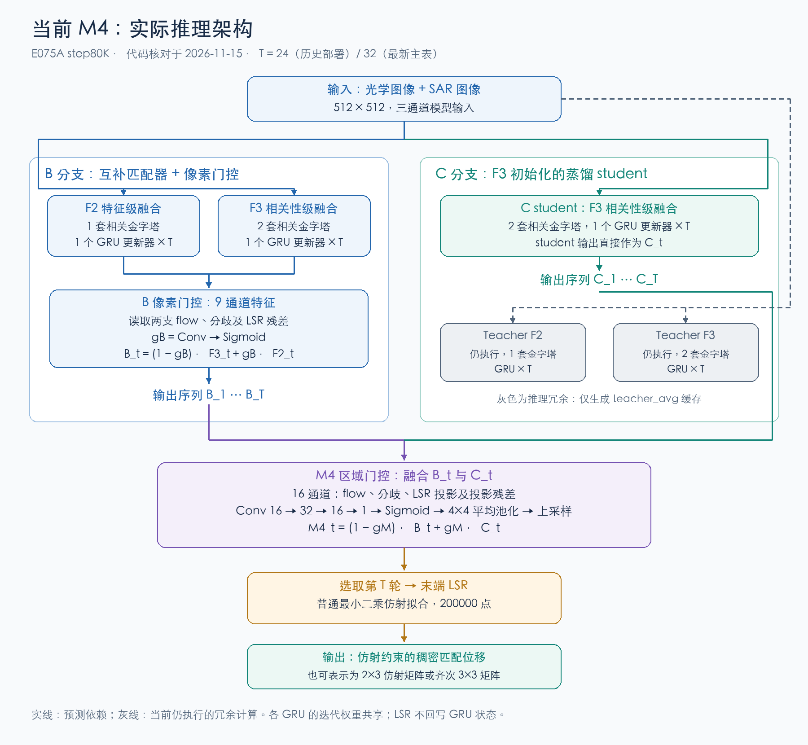
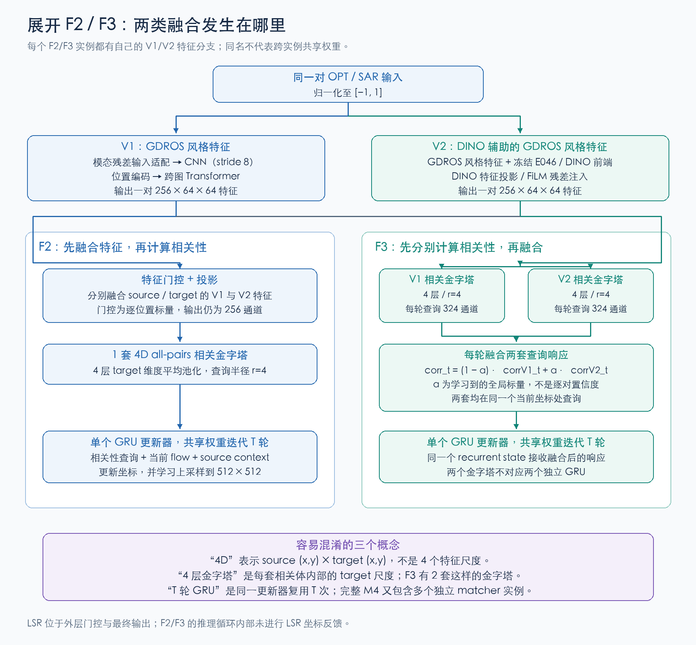

# 当前 M4 网络架构与历史消融盘点

2026-11-15。审计对象：**OS E075A-M4 Region Gate，M4_step80000.pt**，SHA256 `55d6e6cd7e849c5c25723004ef6b7a7c79b8cd55e2665951257cafb07b86d81b`。这也是最近三数据集评测使用的 M4；不是单独在 WHU 训练的 E081A-M4。

本次只读取源代码和既有结果，绘图及整理文档；没有改动模型、重新训练、运行新推理或执行 Git 提交。网络图描述实际已评测实现，不把未来简化方案画成已完成的方法。

## 1. 先用一句话讲清当前方法

当前 M4 是一个**分层融合的稠密匹配系统**：先构建 GDROS 风格与 DINO 辅助两类特征，形成“特征级融合 F2”和“相关性级融合 F3”两类迭代匹配器；B 分支用像素门控融合 F2/F3，C 分支用蒸馏训练得到的 F3 student；最外层 M4 再通过几何特征驱动的区域门控融合 B/C，最后用 LSR 得到仿射约束的位移场。

F2/F3、B/C、M4 是不同层次的历史实验编号。F2/F3 不是特征金字塔的第2/第3层，也不是最近新增的分支。

## 2. 整体架构：预测依赖与实际执行

[可编辑SVG](assets/m4_overall.svg)。实线表示最终预测所依赖的路径；灰色虚线表示当前代码仍会执行、但不参与 C 返回预测的 teacher 路径。

- **B 分支**有两个完整匹配器：F2 与 F3。每轮得到两个 flow，再用9通道特征预测逐像素门控。特征包括两个flow、差值、差值向量范数，以及各自与LSR投影的残差范数。`B_t=(1-gB)*F3_t+gB*F2_t`，gB 是 F2 权重。
- **C 分支**是从F3初始化的student，训练中接受F2/F3平均预测的蒸馏监督，推理返回student的flow序列。当前实现仍先运行两个teacher并保存`last_teacher_avg`；该缓存被训练loss读取，未进入 C 的返回值。
- **M4外层**冻结B/C，只训练区域门控。输入16通道：`B,C,B-C,abs(B-C),LSR(B),LSR(C),abs(LSR(B)-B),abs(LSR(C)-C)`，每项2通道。门控为Conv 16→32→16→1、Sigmoid、kernel/stride=4平均池化、双线性上采样。`M4_t=(1-gM)*B_t+gM*C_t`，gM是C权重。
- **末端LSR**拟合普通最小二乘仿射变换，再转回完整位移场。自由度为6；齐次3×3的最后一行为`[0,0,1]`。这不是任意8自由度单应性，也没有在该推理路径中使用RANSAC/DEGENSAC。

这里“4×4区域池化”指每个4×4像素块的池化：512×512 gate先变成128×128再上采样，**不是全图仅16个区域**。门控卷积在池化前仍处理全分辨率。

## 3. 展开内部匹配器：两个4D金字塔具体在哪里

[可编辑SVG](assets/m4_matcher_detail.svg)。此图展示两类matcher的结构模板，每个实例有自己的网络对象和参数；没有跨实例的自动特征缓存或权重共享。

**V1特征分支**：图像归一化→光学/SAR残差输入适配→GDROS风格CNN（stride8）→通道投影/位置编码→跨图Transformer，输出source/target各256×64×64的特征。

**V2特征分支**：另一套GDROS风格特征，加上冻结E046/DINO前端的跨模态特征，通过投影与小幅FiLM/残差方式注入。DINO辅助不仅用于训练；其前端在实际前向中会被调用。最终M4参数包含此前阶段学到的这些分支参数，不能只凭“GDROS风格”就认为等于官方发布GDROS权重。

**F2特征级融合**：先对V1/V2的source/target特征分别做门控投影融合，再构建**1套**all-pairs CorrBlock金字塔。一个独立的BasicUpdateBlock迭代T次，更新flow与GRU状态。

**F3相关性级融合**：分别为V1/V2构建**2套**all-pairs CorrBlock金字塔。在每轮同一当前坐标上查询两个相关体，将响应按学习到的全局标量α加权，再送入**同一个**BasicUpdateBlock。α不是每对图像自适应的置信度。

每套CorrBlock内部有4层target维度平均池化，radius=4，因此每次查询输出`4*(2*4+1)^2=324`通道。4D表示`source(x,y) × target(x,y)`四个空间维度，不表示四个特征尺度。每个matcher的GRU权重在迭代轮之间共享，但不同matcher有自己的更新器；两套相关体不等于两个GRU。

## 4. LSR与GRU的真实关系

F2/F3推理循环是：查询相关性→GRU更新→坐标加delta→上采样flow。LSR不在这个循环内部，也不把投影坐标反馈到下一轮GRU。

训练时，每轮预测既受到稠密序列损失Lseq监督，也会经`LSR_list`转换后受到几何损失Lgeo监督；C阶段还有蒸馏损失，M4阶段还有门控监督和尾部/熵/平衡项。**几何监督存在，不等于推理中存在几何状态反馈。**

推理时多次LSR主要发生在B门控的特征构造、M4门控的特征构造和末端输出。外层门控对已经生成的各轮flow做融合，也不把融合结果送回内部GRU。因此“多个GRU迭代 + 多轮LSR”虽描述了计算元素，但容易误以为它们交替闭环优化；实际是多匹配器生成序列，再分层门控和末端投影。

## 5. 为什么当前实现较重

以下为**源代码静态调用计数**，不是已测FLOPs、峰值显存或延迟：

| 执行位置 | matcher数 | 构建CorrBlock金字塔数 | BasicUpdateBlock调用次数 |
|---|---:|---:|---:|
| B中的F2 | 1 | 1 | T |
| B中的F3 | 1 | 2 | T |
| C中的student F3 | 1 | 2 | T |
| C中的teacher F2，当前仍执行 | 1 | 1 | T |
| C中的teacher F3，当前仍执行 | 1 | 2 | T |
| 当前代码合计 | **5** | **8** | **5T** |
| 直接参与最终预测的路径合计 | **3** | **5** | **3T** |

“两个4D相关金字塔”准确描述的是**单个F3 matcher**；整个当前M4一次前向实际构建8套。每套内部又含4层。不同matcher顺序执行，因此8套构建次数不等于8套都同时常驻显存。

B门控每轮2次LSR，M4门控每轮2次LSR；单个末端输出合计`4T+1`次LSR，即24轮97次、32轮129次。最近E092一次前向同时导出24/32轮时为130次。这里不包括训练损失、离线诊断和额外导出产生的LSR调用。

E073实例还保留了原始V1/V2子网络自己的更新器，但F2/F3前向只调用它们的特征提取路径，实际迭代使用E073新建的更新器。注册参数中存在未执行模块，因此统计整个state_dict的参数量，不能直接代表实际执行参数量或FLOPs。

上游官方LSR实现还每次构造大网格、把仿射矩阵重复到整幅图，且返回CPU后门控又拷回GPU。这些也是候选开销来源，但必须经过计时确认各自占比。旧`resource_report`不是统一协议的每对推理计时，不能用它声称某模块耗时百分比。

C的teacher路径没有到返回student预测的数据依赖，是优先检查的推理冗余。移除前仍应做输出、数值、内存及运行时等价验证；**本次未修改代码，也未声称已获得加速**。

## 6. 历史消融证据如何解读

下面全部历史数值采用**OS前404对的标准二维向量EPE**，CMR严格`pair_EPE<T`。它们不能与最新424对公开分量口径、WHU或UBCv2表混用。

这些历史404对多次被当作dev用于checkpoint/迭代选择，属于探索性历史对照，不能替代未参与模型选择的确认性测试，也没有完整多训练seed置信区间。本次重新从zzvr读取的是结果卡及训练评测记录，没有重新执行原始预测。

证据分为：同一权重的推理设置对照、独立训练的结构变体对照、诊断性统计、以及只有计划/文件名的项目。不能因为存在`method_ablation.json`就认为完成了严格消融；E072—E075中的不少该文件仅包含`variant`和`best`。

### 6.1 已有较直接证据：迭代轮数

同一M4 step80K、同一404对、同一末端LSR，仅改变读取的迭代输出：

| 配置 | AEPE↓ | CMR@1↑ | CMR@2↑ | CMR@5↑ |
|---|---:|---:|---:|---:|
| 12轮 + 末端LSR | 2.4700 | 54.21% | 75.74% | 87.38% |
| 24轮 + 末端LSR | 2.3613 | 56.68% | 78.96% | 88.86% |
| 32轮 + 末端LSR | 2.4033 | 52.48% | 79.21% | 88.61% |

12→24轮有收益：CMR@1增加约2.48个百分点，CMR@5增加约1.49个百分点；24→32轮没有全面收益。它证明当前训练权重下的迭代预算影响结果，不证明某个GRU结构优于其他更新器，也不是“去掉GRU”的架构消融。

### 6.2 已有较直接证据：末端LSR

同一M4 step80K、24轮、相同预测，比较末端投影前后：

| 配置 | AEPE↓ | CMR@1↑ | CMR@2↑ | CMR@5↑ |
|---|---:|---:|---:|---:|
| 24轮，不加末端LSR | 2.5201 | 46.53% | 77.97% | 88.61% |
| 24轮，加末端LSR | 2.3613 | 56.68% | 78.96% | 88.86% |

末端LSR使AEPE降低约0.159，CMR@1增加约10.15个百分点，CMR@5增加约0.25个百分点。它对精定位有明确的条件性收益。但内部B/M4 gate特征仍保留LSR，不能把此表叫做“完全去掉LSR”的消融；训练中的Lgeo也没有被移除。

### 6.3 已做过：标量门控、区域门控、尾部目标

固定24轮post-LSR，列出同120K训练点与正式保留80K点：

| 配置 | AEPE↓ | CMR@1↑ | CMR@2↑ | CMR@5↑ |
|---|---:|---:|---:|---:|
| M2标量门控，120K | 2.3477 | 55.94% | 79.21% | 88.12% |
| M3标量门控+尾部目标，120K | 2.3903 | 55.45% | 79.70% | 88.12% |
| M4区域门控，120K | 2.3708 | 56.93% | 79.46% | 88.37% |
| M4正式保留点，80K | 2.3613 | 56.68% | 78.96% | 88.86% |

同120K时区域M4相对标量M2，CMR@1约+0.99pp、CMR@5约+0.25pp，但AEPE略差；正式M4-80K相对M2-120K的CMR@1/5各约+0.74pp，AEPE也略差。区域门控不是所有指标都优。

这组是**相关变体对照**：M4与M2/M3不仅pooling不同，还涉及区域/标量监督目标、熵/平衡/尾部/桶损失差别，正式checkpoint训练步数也不同。不能把全部差距单独归因于区域化，不能据此断言某个CVaR/entropy/balance项有独立贡献。

### 6.4 已有同轮数对照：B/C单支、平均、无GT择支、M4

E075A同一80K评测记录中的`branch_baselines`取的是最高迭代数32轮。为避免混用，下面M4也取32轮post-LSR：

| 配置 | AEPE↓ | CMR@1↑ | CMR@2↑ | CMR@5↑ |
|---|---:|---:|---:|---:|
| 仅B分支 | 2.5632 | 40.59% | 71.53% | 90.10% |
| 仅C分支 | 2.6017 | 45.54% | 77.72% | 88.12% |
| B/C固定平均 | 2.4155 | 49.75% | 78.47% | 88.61% |
| 无GT自一致性择支 | 2.3713 | 45.79% | 78.22% | 89.60% |
| M4区域门控 | 2.4033 | 52.48% | 79.21% | 88.61% |

M4比B/C单支精定位更好，但相对固定平均的额外收益较小：AEPE约降低0.0123，CMR@1约+2.72pp，CMR@5相同。自一致性择支在AEPE和CMR@5上反而更好，CMR@1较低。这说明外层复杂gate需要进一步做精度—成本权衡。

固定平均这里为`(LSR(B)+LSR(C))/2`，M4为`LSR((1-g)*B+g*C)`，投影/融合顺序不同；所以它是已实现策略比较，也不是只替换gate一个算子的完全隔离对照。

记录中的`gt_oracle_chooser`由逐像素最小误差构造，是GT辅助诊断上界，不能当成可部署的逐对选择器或方法最终成绩；本报告未把它放进无GT性能表。

### 6.5 已做过：特征级、相关性级、多头输出级融合

E073A各训练到120K，为统一比较，全部固定24轮post-LSR（F4的历史best是12轮，本表没有混用）：

| 配置 | AEPE↓ | CMR@1↑ | CMR@2↑ | CMR@5↑ |
|---|---:|---:|---:|---:|
| F2：特征级融合 | 3.0074 | 22.28% | 60.89% | 89.11% |
| F3：相关性级融合 | 2.8286 | 35.64% | 62.62% | 88.37% |
| F4：双GRU输出融合 | 3.1326 | 25.50% | 59.90% | 83.66% |

F3相对F2精定位更好，但CMR@5略差；双独立头的F4在该训练设置下没有超过F2/F3。因此历史证据不支持“多放GRU头必然更好”。

它比较的是融合位置与对应网络结构，而不是最终M4里“2套相关体vs1套”的严格消融。缺少保持其余训练条件、参数/计算预算明确匹配的F3只留V1、只留V2、两者融合对照。

### 6.6 有早期前端对照，但不能据此证明DINO必需

E072A两个60K模型，均为12轮post-LSR：

| 配置 | AEPE↓ | CMR@1↑ | CMR@2↑ | CMR@5↑ |
|---|---:|---:|---:|---:|
| V1：GDROS风格前端，60K | 4.1930 | 8.66% | 33.17% | 76.49% |
| V2：增加DINO辅助，60K | 4.3024 | 9.90% | 43.32% | 69.55% |

V2提高低阈值成功率，但AEPE与CMR@5较差；表明两类表示存在不同取舍。它们是独立训练网络，不是从最终M4移除DINO后再等预算训练的对照。因此DINO对最终M4的净收益仍需验证。

### 6.7 方法演化链能解释来源，不能当作逐模块增益相加

下表各自选定checkpoint，统一24轮post-LSR：

| 配置 | AEPE↓ | CMR@1↑ | CMR@2↑ | CMR@5↑ |
|---|---:|---:|---:|---:|
| F2，120K | 3.0074 | 22.28% | 60.89% | 89.11% |
| F3，120K | 2.8286 | 35.64% | 62.62% | 88.37% |
| B：F2/F3像素门控，180K | 2.5053 | 44.80% | 72.77% | 89.36% |
| C：F3蒸馏student，180K | 2.5697 | 48.76% | 76.98% | 87.87% |
| M4：B/C区域门控，80K | 2.3613 | 56.68% | 78.96% | 88.86% |

B在F2/F3之上训练门控；C在F3之上继续训练并接受蒸馏；M4再训练外层门控。训练预算、目标和网络容量同时变化，这些数字不能解释成“每加一层一定获得多少收益”。尤其C相对F3的提升既可能来自继续训练，也可能来自蒸馏；缺少相同步数、无蒸馏C对照。

### 6.8 已完成的失败归因诊断，不是模块有效性消融

E075B/C/D记录显示，历史标准向量口径45个≥5失败中41个B/C都失败；只有4个至少一支已经成功。没有发现普遍的iter12成功→iter24失败，或pre-LSR成功→post-LSR失败现象。它支持把主要尾部问题追溯到共享的特征—相关性—更新过程，而非仅改M4择支。

这些结论仅针对历史404对诊断。最新424对**公开分量口径25个失败**不是同一集合，不能把41/45直接套成25对的分解。诊断也没有证明“LSR无用”或“GRU已经足够好”。

## 7. 哪些问题目前仍没有答案

| 想证明的贡献 | 查到的既有证据 | 仍缺的关键对照 |
|---|---|---|
| DINO辅助是否必需 | V1/V2早期比较，F2/F3变体 | 最终方法的无DINO、相同训练预算版本 |
| 两套4D相关体是否都有效 | F2/F3融合位置比较 | 同一F3架构只留V1、只留V2、双相关体 |
| B中的F2路径是否值得其成本 | F2/F3独立结果，B及C对照 | B去F2、去F3，以及最终M4对应简化 |
| C student是否需要蒸馏 | F3到C有提升 | C同预算有/无蒸馏 |
| 区域gate本身的贡献 | M2/M3/M4变体 | 同损失、同步数、同seed，仅改scalar/region |
| gate中的几何特征是否必需 | 有完整gate，未见剥离结果 | B和M4分别去LSR特征，分歧/原flow特征保持 |
| 训练几何损失Lgeo的贡献 | 有pre/post末端LSR评测 | 同预算移除Lgeo重训，与末端LSR开关分开 |
| 内部LSR计算是否每轮必要 | 当前代码每轮计算；已有迭代曲线 | 只在需要的输出轮计算gate/LSR，先做数值等价 |
| GRU架构或多头的贡献 | 12/24/32预算，F4变体 | 参数/训练预算明确匹配的更新器或头数对照 |
| 尾部/门控/熵/平衡损失各自贡献 | M1/M2/M3/M4混合变体 | 每次只改一个损失项的独立训练 |
| C teacher推理是否有用 | 源码表明无到返回值的数据路径 | 移除teacher后的严格输出等价与实测加速 |

没有找到的项目表述为“在本次检查范围内未找到已完成记录”，不据此断言远端任何角落都绝无该实验。早期E000系列其他稀疏匹配方法的消融、E081之后新候选模块的实验，不自动构成当前OS-M4的组件证据。

## 8. 现在可以保留的判断

1. **直接证据最清楚的是末端LSR与合理迭代预算**：末端LSR的精定位收益大；12→24轮有收益，继续加轮数不是稳定增益。
2. **融合策略有历史支持，但并非每层复杂度都被证明值得**：F2/F3有精度—尾部互补，M4优于单支；区域门控相对简单融合的增益较小，且并非所有指标占优。
3. **DINO、双相关体、蒸馏和各损失项的净贡献仍未被完整隔离**，不能直接写成已经消融证明的创新点。
4. **已定位到明确的实现冗余候选**：C推理中的teacher、对不会被使用的中间输出计算外层gate与LSR。它们值得优先做等价性验证，随后再考虑有精度代价的架构压缩。

若下一步启动实验，先做无需训练的输出等价与计时检查，再用预声明且未参与选择的数据拆解核心结构贡献。测试集已产生的历史结果用于诊断，不能继续充当无限次架构选择的无偏证据。本次没有启动这些新实验。

## 9. 代码与证据索引

- E072特征实现：`research/remote_stage/os/e072a_layerwise_frontend_alignment.py`，OfficialLikeFrontend在115行、E046FiLM在140行、E072Matcher在159行。
- E073匹配器：`research/remote_stage/os/e073a_v1_v2_fusion_longtrain.py:195`；分支特征234行、GRU循环241行、F2/F3前向257行。
- E074 B/C：`research/remote_stage/os/e074a_f2_f3_twostage_fusion.py:124`；C推理168—172行、蒸馏loss在train中。
- E075 M4：`research/remote_stage/os/e075a_preserve_high_precision_recover_c2c5.py:176`门控定义、198行PairFusion、208行特征、213行前向。
- [源码结构及静态调用审计](CODE_ARCHITECTURE_AUDIT.json)：记录本机源码SHA，已与zzvr当前E092所用四份源文件一致。
- [历史卡原文快照](evidence/remote_history_snapshot.json)：含每个远端文件路径、原文与SHA，完整保留smoke/中间运行身份；性能表只采用404对正式结果。
- [历史评测投影](evidence/training_eval_projection.json)：每个原文件记录raw SHA与提取规则，仅省略顶层训练curves日志，保留evals、checkpoint SHA、RUN_MANIFEST等；未把投影哈希冒充原文件哈希。
- [上游源码快照](evidence/upstream_code_snapshot.json)：CorrBlock、update、LSR、FeatureEncoder、E046加载器。仅相关子图进行了代码级阅读，没有宣称完整复审所有E000—E091方法及所有DINO内部模块。
- 已复核[旧OS诊断](../E075D_OS_DIAGNOSTIC_REPORT.md)和[当前OS主模型说明](../CURRENT_BEST_OS_METHOD_20260913.md)。最新完整三数据集指标见[对照总结](../THREE_DATASET_FROZEN_OS_M4_COMPARISON_20261115.md)，不能与本报告历史向量口径混用。
